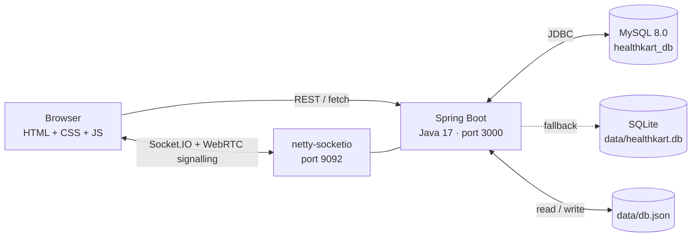

# HealthKart-java
HealthKart is a smart healthcare platform for medicines, product comparison, doctor consultations, appointments, prescriptions, health records, reminders, and orders—all in one place.
<div align="center">

# 💚 HealthKart (Java Project)

### Healthcare Made Simple & Affordable

Search medicines · Compare prices · Consult doctors · Manage your health — all in one place.

**☕ Java 17 + Spring Boot backend · Pure JDBC · MySQL with SQLite fallback**

[](https://openjdk.org/)
[](https://spring.io/projects/spring-boot)
[](https://github.com/mrniko/netty-socketio)
[](https://www.mysql.com/)
[](https://www.sqlite.org/)
[](https://www.docker.com/)
[](LICENSE)

**Maintained by [Priyanshu Kumar ](https://github.com/priyanshukumarsingh8111)**

</div>

---

## 📖 About

Healthcare tasks are usually scattered across different apps: one to find medicines, another to book a doctor, another to keep prescriptions. **HealthKart** brings them into one connected journey:
> **Search → Compare → Consult → Connect → Manage**

Patients can discover medicines, compare prices, book doctors, join live video consultations, receive digital prescriptions and get medicine reminders. Doctors have their own dashboard to manage appointments and issue prescriptions during a call.

This repository is the **Java edition** of [HealthKart](https://github.com/priyanshukumarsingh8111/HealthKart). The same HTML/CSS/JavaScript frontend is kept, while the Node.js backend is rebuilt in **Java with Spring Boot** and a **pure JDBC** data layer (no ORM).

## ✨ Features

|    | Feature                      | Details                                                                                                |
| --- | ---------------------------- | ------------------------------------------------------------------------------------------------------ |
| 🔍  | **Medicine search**          | Browse and search medicines and health devices, with detail pages                                      |
| ⚖️ | **Price comparison**         | Compare products side by side before buying                                                            |
| 🛒  | **Cart, wishlist, checkout** | Add to cart, save favourites, place orders, view order history                                         |
| 🩺  | **Doctor directory**         | Doctor listing with individual profile pages                                                           |
| 📅  | **Appointment booking**      | Slot-based booking, cancellation and a "My Appointments" view                                          |
| 📹  | **Video consultation**       | WebRTC video calls with in-call chat, screen sharing and in-call prescriptions                         |
| 💊  | **Prescriptions**            | Doctors issue prescriptions; patients view them in their account                                       |
| ⏰  | **Reminders**                | Medicine and yoga reminders, generated automatically from prescriptions recommended by the doctor      |
| 🔔  | **Notifications**            | Appointment and prescription alerts with mark-as-read                                                  |
| 🗂️ | **Health records**           | Personal records on the "My Health" page                                                               |
| 🤖  | **AI health agent**          | Answers questions, explains medicines, schedules reminders from plain text                             |
| 🧭  | **Symptom triage**           | Describe symptoms to get a suggested specialty, urgency level and doctor                               |
| 🔐  | **Authentication**           | Sign up and log in, with patient and doctor flows                                                      |
| 🗄️ | **JDBC database layer**      | Relational storage through plain JDBC, with MySQL as primary and SQLite as a zero-setup fallback       |
| 🖥️ | **Swing GUI launcher**       | Optional desktop launcher built with Java Swing and the FlatLaf theme                                  |

> **Note:** The AI agent and triage are **rule-based** (keyword and intent matching) and run on the project's own server. They are not connected to an external LLM and are not a substitute for professional medical advice.

## 🧰 Tech Stack

| Layer          | Technology                                                                 |
| -------------- | -------------------------------------------------------------------------- |
| Frontend       | HTML5, CSS3, vanilla JavaScript (ES modules), Font Awesome 6               |
| Backend        | Java 17, Spring Boot 3.3.5 (`spring-boot-starter-web`), Maven              |
| Real-time      | Socket.IO via `netty-socketio` 2.0.11 (signalling, chat, call events) and WebRTC (media) |
| Database       | Pure JDBC: MySQL 8.0 (primary, `mysql-connector-j` 9.3.0), SQLite (fallback, `sqlite-jdbc` 3.46.0.0), H2 2.2.224 |
| Data file      | JSON file (`data/db.json`) managed by the server                           |
| Desktop GUI    | Java Swing with FlatLaf 3.5.1                                              |
| Testing        | Spring Boot Starter Test (JUnit)                                           |
| DevOps         | Docker, Docker Compose                                                     |

## 🏗️ Architecture



## 📁 Project Structure

```
HealthKart-java/
├── java/com/healthkart/      # Spring Boot backend source (controllers, services, JDBC layer, GUI)
├── resources/                # Backend resources
├── test/java/com/healthkart/ # Unit and integration tests
├── public/                   # Frontend: index.html, pages/, js/, css/, images/, style.css
├── data/                     # JSON data file and local SQLite database
├── application.properties    # Server, Socket.IO and database configuration
├── pom.xml                   # Maven build (healthkart-server 1.0.0)
├── Dockerfile                # Container image
├── docker-compose.yml        # App + database stack
├── run-app.bat               # Windows launcher for the web server
├── run-gui.bat               # Windows launcher for the Swing GUI
├── LICENSE
└── README.md
```

## 🚀 Getting Started

**Requirements:** [JDK 17+](https://adoptium.net/), [Maven 3.6+](https://maven.apache.org/), and optionally [MySQL 8.0](https://dev.mysql.com/downloads/mysql/). A modern browser with camera and microphone access is needed for video calls.

### 1. Clone the repository

```bash
git clone https://github.com/priyanshukumarsingh8111/HealthKart-java.git
cd HealthKart-java
```

### 2. Configure the database

Database settings live in `application.properties`:

```properties
# 'mysql' (primary) or 'sqlite' (zero-setup fallback)
healthkart.db.type=mysql

healthkart.db.mysql.url=jdbc:mysql://localhost:3306/healthkart_db?useSSL=false&allowPublicKeyRetrieval=true&serverTimezone=UTC&createDatabaseIfNotExist=true
healthkart.db.mysql.username=root
healthkart.db.mysql.password=<your-mysql-password>

healthkart.db.sqlite.url=jdbc:sqlite:data/healthkart.db
```

- **MySQL:** start your MySQL server and set your own username and password. The `healthkart_db` database is created automatically.
- **No MySQL?** Set `healthkart.db.type=sqlite` to run with the local SQLite file, no installation needed.

> ⚠️ Never commit real credentials. Keep your own password out of version control.

### 3. Build

```bash
mvn clean package
```

This produces `target/healthkart-server-1.0.0.jar`.

### 4. Run the app

```bash
java -jar target/healthkart-server-1.0.0.jar
```

Or on Windows, just double-click **`run-app.bat`**.

| Service              | URL                                          |
| -------------------- | -------------------------------------------- |
| Web interface        | <http://localhost:3000>                      |
| Database diagnostics | <http://localhost:3000/pages/database.html>  |
| Socket.IO server     | `localhost:9092`                             |

Set the `PORT` environment variable to use a different web port.

### 5. Desktop GUI (optional)

On Windows, run **`run-gui.bat`** to launch the Swing desktop interface.

### 6. Run with Docker (optional)

```bash
docker compose up --build
```

### 7. Run the tests (optional)

```bash
mvn test
```

## 🔌 API Reference

Base URL: `http://localhost:3000`

**Doctors & medicines**

| Method | Endpoint             | Description      |
| ------ | -------------------- | ---------------- |
| `GET`  | `/api/doctors`       | List all doctors |
| `GET`  | `/api/doctors/:id`   | Get one doctor   |
| `GET`  | `/api/medicines`     | List medicines   |
| `GET`  | `/api/medicines/:id` | Get one medicine |

**Appointments**

| Method | Endpoint                             | Description                                                 |
| ------ | ------------------------------------ | ----------------------------------------------------------- |
| `GET`  | `/api/appointments/slots`            | Available slots for a doctor on a date (`doctorId`, `date`) |
| `POST` | `/api/appointments/book`             | Book an appointment                                         |
| `GET`  | `/api/appointments/my`               | Appointments for the current patient                        |
| `GET`  | `/api/appointments/doctor/:doctorId` | Appointments for a doctor                                   |
| `POST` | `/api/appointments/:id/cancel`       | Cancel an appointment                                       |
| `POST` | `/api/appointments/:id/complete`     | Mark an appointment as completed                            |
| `POST` | `/api/webrtc/verify-access`          | Verify a user may join a call room                          |

**Prescriptions, reminders & notifications**

| Method   | Endpoint                       | Description                                   |
| -------- | ------------------------------ | --------------------------------------------- |
| `GET`    | `/api/prescriptions`           | List prescriptions (filter by `email`)        |
| `GET`    | `/api/prescriptions/:id`       | Get one prescription                          |
| `POST`   | `/api/prescriptions`           | Issue a prescription (can generate reminders) |
| `GET`    | `/api/reminders`               | List reminders (filter by `email`)            |
| `POST`   | `/api/reminders`               | Create a reminder                             |
| `PUT`    | `/api/reminders/:id`           | Update a reminder                             |
| `DELETE` | `/api/reminders/:id`           | Delete a reminder                             |
| `GET`    | `/api/notifications`           | List notifications                            |
| `POST`   | `/api/notifications/mark-read` | Mark notifications as read                    |

**AI**

| Method | Endpoint         | Body                                       |
| ------ | ---------------- | ------------------------------------------ |
| `POST` | `/api/ai/chat`   | `{ "message": "...", "userEmail": "..." }` |
| `POST` | `/api/ai/triage` | `{ "symptoms": "..." }`                    |

**Socket.IO events** (served on port `9092`)

| Event                                                              | Purpose                            |
| ------------------------------------------------------------------ | ---------------------------------- |
| `register_user`                                                    | Register a connected user          |
| `start_doctor_call` · `accept_doctor_call` · `decline_doctor_call` | Call lifecycle                     |
| `join_room` · `end_call`                                           | Join and leave a consultation room |
| `webrtc_offer` · `webrtc_answer` · `ice_candidate`                 | WebRTC signalling                  |
| `in_call_chat`                                                     | Chat during a call                 |
| `in_call_prescription`                                             | Send a prescription during a call  |
| `screen_share_status`                                              | Screen-share state updates         |

## 🌐 Deployment

- **Docker:** Build the image from the included `Dockerfile`, or bring up the full stack with `docker compose up --build`.
- **Any JVM host:** Package with `mvn clean package` and run the JAR on Render, Railway, an AWS EC2 instance, or a VPS. The app serves both the frontend (from `public/`) and the API from one origin. Set `PORT` if your host requires it, and make sure the Socket.IO port (`9092`) is reachable for video calls.

## ⚠️ Known Limitations

HealthKart is a project prototype. Before production use:

- **Roles are inferred on the client** from the login email. Use server-verified roles and proper session or token authentication.
- **No payment gateway.** Checkout stores orders locally in the browser.
- **Rule-based AI.** It gives general information only.
- **Socket.IO needs its own port**, since `netty-socketio` cannot share Spring's port.
- **Secrets belong in environment variables**, not in `application.properties`.

## 🗺️ Roadmap

- [ ] Move database credentials to environment variables
- [ ] Secure, server-verified authentication and roles
- [ ] Payment gateway integration
- [ ] Live pharmacy and inventory integrations
- [ ] TURN server for reliable video calls across networks
- [ ] LLM-powered health assistant with safety guardrails
- [ ] CI pipeline with automated tests

## 🤝 Contributing

Contributions are most welcome:

1. Fork the repository
2. Create a branch: `git checkout -b feature/your-feature`
3. Commit: `git commit -m "Add your feature"`
4. Push: `git push origin feature/your-feature`
5. Open a Pull Request

## 📄 License

Released under the **MIT License**. See [LICENSE](LICENSE).

## 👥 Author
"Team PharmaCoders"
**Priyanshu Kumar Singh** · [@priyanshukumarsingh8111](https://github.com/priyanshukumarsingh8111)

---

<div align="center">

**If you find HealthKart useful, please give it a ⭐**

</div>

